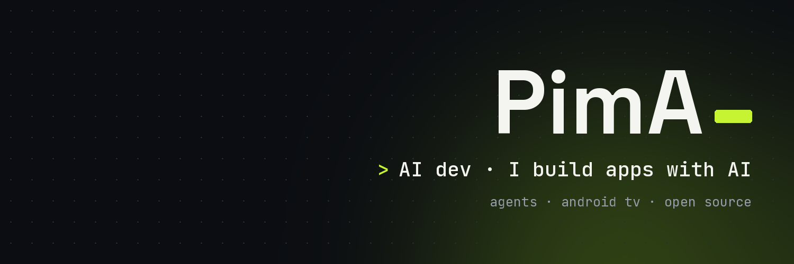

  

### Hi, I'm PimA

I build apps with AI, from Toulouse. I take an idea all the way: design, code, tests on the real device, release.

---

### Project of the moment: [OwnYourTV](https://github.com/pimado1/ownyourtv)

**You paid for it. Own it.** OwnYourTV switches off the ads and tracking that Android TV and Google TV sets come
with, and gives them a living home screen: a night sky, your apps as a 3D deck, the weather. A step-by-step
assistant does it all from the remote, no computer needed, and one button puts everything back.
In 6 languages, open source (MIT), and it already recognises 345 TV models.

**Install from your TV:** in the Downloader app, type **`8225348`**

**[Website](https://pimado1.github.io/ownyourtv/)** · **[See the project](https://github.com/pimado1/ownyourtv)** · **[Download the latest version](https://github.com/pimado1/ownyourtv/releases/latest)** · **[TVs it works on](https://github.com/pimado1/ownyourtv/issues?q=label%3Atv-report)**

---

### What I use

`Kotlin` · `Java` · `Android` · `Python` · `Cloudflare Workers` · `Claude Code` · `Git`

### Follow me

[X / Twitter](https://x.com/PimAoff)
