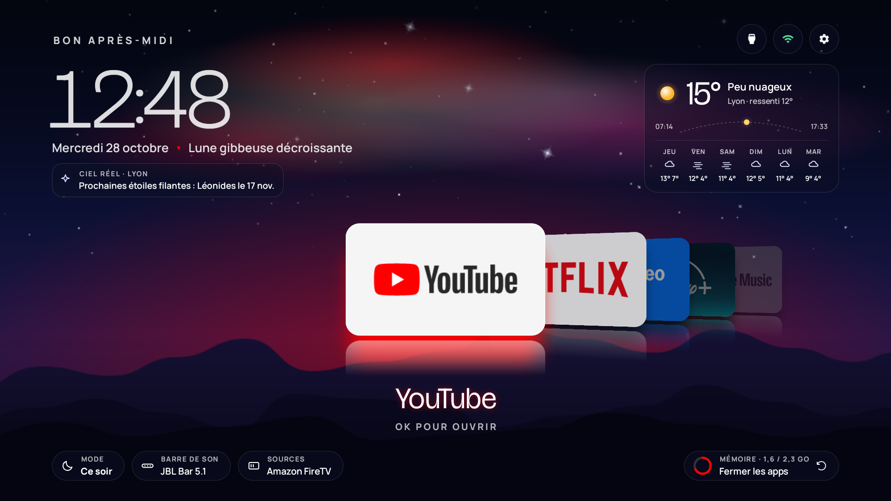

  

### Salut, moi c'est PimA

Je construis des apps avec l'IA, à Toulouse. Je pars d'une idée, je la conçois et je la livre jusqu'au bout :
design, code, tests sur le vrai appareil, mise en ligne.

---

### Projet du moment : [Horizon](https://github.com/pimado1/horizon-tv)

Un accueil vivant pour Android TV et Google TV : un ciel de nuit animé, une aurore boréale qui prend la couleur
de l'app sélectionnée, tes apps en jeu de cartes 3D, la météo de ta ville et la reprise de tes séries.
Sans pub, sans compte, sans root, et open source.

**[Voir le projet](https://github.com/pimado1/horizon-tv)** · **[Télécharger](https://github.com/pimado1/horizon-tv/releases/latest)**

---

### Ce que j'utilise

`Java` · `Android` · `Python` · `Claude Code` · `Git`

### Me suivre

[X / Twitter](https://x.com/PimAoff)
